# EveryData — Discover and query structured public data through MCP

<p align="center">
  <picture>
    <source media="(prefers-color-scheme: dark)" srcset="assets/hero-dark.svg">
    <source media="(prefers-color-scheme: light)" srcset="assets/hero-light.svg">
    
  </picture>
</p>

<p align="center">
  <a href="https://cursor.com/en/install-mcp?name=everyinfra&config=eyJ1cmwiOiJodHRwczovL2FwaS5ldmVyeWluZnJhLmNvbS9tY3AiLCJoZWFkZXJzIjp7IkF1dGhvcml6YXRpb24iOiJCZWFyZXIgPEFQSSBLZXk%2BIn19"></a>
  <a href="https://vscode.dev/redirect/mcp/install?name=everyinfra&config=%7B%22type%22%3A%22http%22%2C%22url%22%3A%22https%3A%2F%2Fapi.everyinfra.com%2Fmcp%22%2C%22headers%22%3A%7B%22Authorization%22%3A%22Bearer%20%3CAPI%20Key%3E%22%7D%7D"></a>
  <a href="https://github.com/everyinfra/everyinfra-agent-plugins#claude-code"></a>
  <a href="https://github.com/everyinfra/everyinfra-agent-plugins#codex"></a>
</p>

<p align="center">
  <a href="https://github.com/everyinfra/everyinfra-agent-plugins/stargazers"></a>
  &nbsp;<b>Star the main repo and get $1 in credit.</b> <a href="https://everyinfra.com/en/docs?utm_source=github&utm_medium=readme&utm_campaign=everydata-plugin&utm_content=star_line#quickstart">How to claim →</a>
</p>

<p align="center"><b>English</b> · <a href="README.zh-CN.md">简体中文</a> · <a href="README.es.md">Español</a></p>

> [!TIP]
> **This repository holds one skill: EveryData.** The complete EveryInfra plugin (10 skills, the remote MCP server at `https://api.everyinfra.com/mcp`, and setup for Claude Code, Codex, Cursor and VS Code) lives in **[everyinfra/everyinfra-agent-plugins](https://github.com/everyinfra/everyinfra-agent-plugins)**. The buttons above connect the MCP server; the per-host plugin installs are in the main repo.

[Setup](docs/setup.md) · [Workflow](docs/workflow.md) · [Prompts](examples/prompts.md) · [Capability reference](docs/reference.md) · [API documentation](https://api.everyinfra.com/docs)

<sub>Numbers in the image come from the live catalog on 2026-10-24; the live catalog and tool schemas are authoritative.</sub>

> **Update (2026-10-09):** the two data cleanup tools have been retired. To clean, classify,
> extract or summarize the data you collect, use the [AI API](https://everyinfra.com/en/products/ai):
> OpenAI-compatible `POST /api/v1/chat/completions`, also available as the MCP tool
> `everyinfra_chat`. It is free for accounts that have topped up, with per-minute limits that follow
> cumulative top-ups.

EveryData is a standalone EveryInfra agent skill for querying structured public data through MCP. It discovers supported platform actions and their live schemas before requesting records, so required inputs, returned fields and pagination limits stay tied to the actual API contract.

A useful data query starts with an actual supported action, not a guessed endpoint. EveryData helps an agent discover the current public-data catalog, inspect a platform/action schema and request structured results with the fields and limits that the service really exposes.

Use it for a bounded lookup or collection where records matter more than a prose answer: an entity, a list of public records or a supported platform action. The live catalog determines what can be queried today.

## What you can do

- Find the supported action for a public-data task before choosing parameters.
- Inspect required fields, optional filters and the page-size ceiling.
- Return available records while distinguishing empty, partial and failed requests.

## Quick start

This is a standalone, one-skill **MCP workflow** package, not a new API service. It requires a compatible agent host and the configured access described in [setup](docs/setup.md). Local package validation does not establish live API availability.

Install the source repository in Codex after reviewing its contents. These commands add a GitHub-backed repository catalog, not an official marketplace endorsement:

```bash
codex plugin marketplace add everyinfra/everydata-plugin
codex plugin add everydata@everydata-plugin
```

For a local checkout, replace the first command's source with `.`. [Setup](docs/setup.md) also covers Claude Code and the separate service connection.

Configure access once, then ask:

> Find the current public-data capability for this platform and list the required inputs before making any paid request.

This initial prompt is scoped to inspection or preparation. Review any paid operation or external side effect before proceeding. Claude Code instructions and Cursor packaging boundaries are in [setup](docs/setup.md).

## How the workflow works

1. Use everyinfra_list_capabilities to identify the applicable platform and action.
2. Read the live action schema and any returned availability, max_limit and price fields.
3. Match the user request to required parameters; ask for genuinely missing inputs instead of inventing them.
4. Use everyinfra_call_api for the authorized query, respecting its current pagination contract.
5. Return the useful structured fields and disclose partial results, omitted fields and observed billing.

### What a useful result contains

A schema-aware result containing the requested fields when available, plus a clear explanation of missing or partial data. A single successful page is not a claim of complete platform coverage.

## When to use this skill

EveryData is for supported structured records. EverySearch retrieves web evidence. Data Export adds row limits, pagination checkpoints, deduplication and file validation to a supported EveryData action.

## Limits and safety

- No hard-coded platform inventory or promise of fields absent from the live schema.
- No guarantee of historical completeness, private records or unrestricted platform access.
- This product-level skill does not promise a validated CSV artifact; use the export workflow when a file is the deliverable.

The package contains one skill and does not grant permissions or register a duplicate MCP connection. Never put credentials in prompts, checked-in files, screenshots or shared logs. Discovery, API execution, billing and a final external result are separate states. See [security](SECURITY.md).

## Frequently asked questions

### Which platforms and fields are supported?

Use live capability discovery. This repository intentionally does not freeze a platform count or a list that may become outdated.

### Can it get fields missing from the response?

No. A field must be supported and returned by the current customer-facing contract. Missing values are reported, not inferred.

### Will one request fetch all records?

Not necessarily. Pagination and limits are action-specific. State the collected scope and do not equate one page with a complete dataset.

### How do I clean or label the records I collect?

Pass them to the [AI API](https://everyinfra.com/en/products/ai) (MCP tool `everyinfra_chat`, or
OpenAI-compatible REST). It is free for accounts that have topped up, with per-minute limits that
follow cumulative top-ups; describe the output format in the prompt and validate the result before
using it.

## Validate and contribute

```bash
python3 scripts/validate.py
```

This offline check validates packaging, local documentation links, the single-skill boundary, metadata and fixtures. It does not send messages, allocate resources or verify a production account. [Contribution guidance](CONTRIBUTING.md) and [the release checklist](RELEASING.md) describe the remaining checks.

Source publication, tagged releases, official marketplace acceptance and live service verification are separate milestones. Maintained by [EveryInfra](https://everyinfra.com). Licensed under [Apache-2.0](LICENSE).
